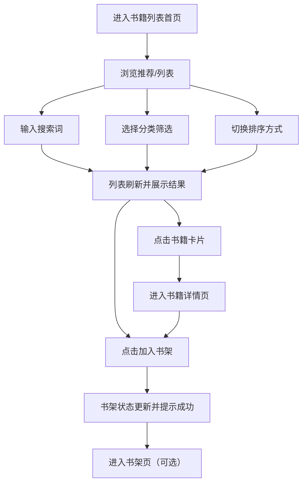

## 1. 产品概述
面向移动端优先的“书籍列表首页”，用于快速发现、筛选并进入书籍阅读/详情。
- 解决用户“找不到想看的书/不知道看什么”的问题，提供高密度但不拥挤的书单浏览体验
- 价值：更高的停留与转化（进书籍/加书架），更低的决策成本

## 2. 核心功能

### 2.1 用户角色（可选）
本需求不区分用户角色（默认游客可用）。

### 2.2 功能模块
1. **书籍列表首页**：推荐区、分类筛选、搜索、排序、书籍列表、分页/加载更多、快速操作
2. **书籍详情页（可复用现有结构或后续补齐）**：书籍信息、简介、标签、加入书架/开始阅读
3. **书架页（现有）**：已加入书架的书籍管理与入口

### 2.3 页面明细
| 页面名称 | 模块名称 | 功能描述 |
|---|---|---|
| 书籍列表首页 | 顶部导航/标题区 | 展示站点标题、入口按钮（书架/搜索），顶部吸顶（可选） |
| 书籍列表首页 | 推荐区（可选） | 3–6 本编辑精选/热门推荐，支持横向滑动 |
| 书籍列表首页 | 搜索框 | 关键字搜索（书名/作者），支持清空与实时联想（可选） |
| 书籍列表首页 | 分类筛选 | 分类/题材筛选（如：玄幻、都市、科幻、历史等），支持“全部” |
| 书籍列表首页 | 排序切换 | 最新/最热/评分（mock 数据可用），切换即刷新列表 |
| 书籍列表首页 | 书籍卡片列表 | 封面、书名、作者、标签、简介摘要、热度/评分（可选） |
| 书籍列表首页 | 快速操作 | 卡片内“加入书架/已在书架”状态切换（本地持久化可选） |
| 书籍列表首页 | 加载更多 | 分页或“加载更多”，展示 loading/空态/错误态 |
| 书籍详情页 | 基本信息 | 封面、书名、作者、字数/状态（可选）、标签 |
| 书籍详情页 | 操作区 | 加入书架、开始阅读（可先跳转占位） |
| 书架页 | 书架列表 | 展示已加入书架书籍、移除/排序（可选） |

## 3. 核心流程
用户从首页进入，使用搜索/筛选/排序缩小范围，查看书籍信息并加入书架或进入详情。

## 4. 用户界面设计
### 4.1 设计风格
- 视觉方向：杂志感书店（Editorial Bookstore）——大标题、细分隔线、克制的色块与高对比文本
- 主色：墨黑 #101114 / 纸白 #F6F1E6
- 点缀色：赭红 #B24A3B 或 酸橙绿 #A6D73B（用于标签/状态）
- 按钮：细边框+轻微内阴影，hover/active 有明显反馈
- 字体：中文优先选择具有书卷气的衬线标题 + 现代无衬线正文（实现上使用系统字体兜底）
- 布局：顶部标题区 + 筛选条 + 卡片列表；卡片间距大于常规列表以提升“阅读感”
- 图标：线性图标或极简符号（不使用花哨拟物）

### 4.2 页面设计概览
| 页面名称 | 模块名称 | UI 元素 |
|---|---|---|
| 书籍列表首页 | 顶部标题区 | 大标题、右侧操作按钮；背景可用轻纹理（CSS） |
| 书籍列表首页 | 筛选/排序条 | 胶囊/下划线风格切换；吸顶（可选） |
| 书籍列表首页 | 书籍卡片 | 左封面右信息；标签高对比；hover 提升阴影与轻微位移 |
| 书籍列表首页 | 空态/错误态 | 插画占位（可选）+清晰文案+重试按钮 |

### 4.3 响应式
- 桌面优先：宽屏使用两列或三列卡片栅格；移动端退化为单列
- 触控优化：筛选条支持横向滚动；卡片可点击区域足够大
