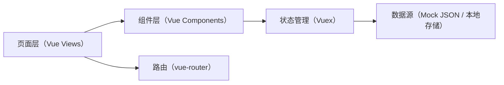
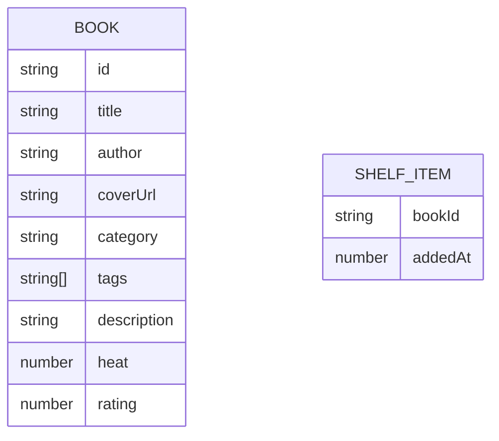

## 1. 架构设计
基于现有 Vue2 工程实现单页应用首页改造与数据流补齐，数据以本地 mock 为主，逐步可替换为真实接口。

## 2. 技术说明
- 前端：Vue@2 + Vue Router@3 + Vuex@3（沿用现有）
- 构建：Vue CLI Service@3（沿用现有）
- 样式：现有基础样式（src/assets/css）+ 页面级样式补充（避免引入新依赖）
- 数据：首期采用 mock 数据（常量/JSON），书架状态可选 localStorage 持久化

## 3. 路由定义
沿用现有嵌套路由结构，在容器页中呈现“书籍列表首页”内容；如需更清晰的路由，可新增显式路径并逐步迁移。

| 路由 | 用途 |
|---|---|
| / | 入口，默认呈现容器页与默认子页 |
| /（默认子页） | 书籍列表首页（本次改造目标） |
| /book/:id（可选） | 书籍详情页（若现有未实现，可先占位） |
| /bookshelf（可选） | 书架页（映射现有 bookrack 结构或后续补齐） |

## 4. 数据模型（前端）
### 4.1 数据模型定义

### 4.2 状态与派生数据
- books：完整书籍列表（mock）
- query：搜索关键字
- category：当前分类
- sort：排序方式（hot/new/rating）
- shelf：书架集合（Set/Map），用于快速判断“是否已加入”
- filteredBooks：根据 query/category/sort 计算得到的展示列表

## 5. 组件拆分建议
- 视图页
  - Home/Container：承载筛选条件与列表渲染，负责触发数据加载与状态更新
- 组件
  - BookListHeader：标题区 + 入口按钮
  - BookFilterBar：分类与排序切换（横向滚动）
  - BookSearchBox：搜索输入、清空
  - BookCard：封面、信息、标签、加入书架按钮
  - EmptyState / ErrorState：空态/错误态

## 6. 可替换为接口的边界（后续）
当接入后端时，将 Vuex actions 中的数据获取替换为 API 调用，并保持页面与组件层不变：
- GET /api/books?query=&category=&sort=&page=
- POST /api/shelf { bookId }
- DELETE /api/shelf/:bookId
